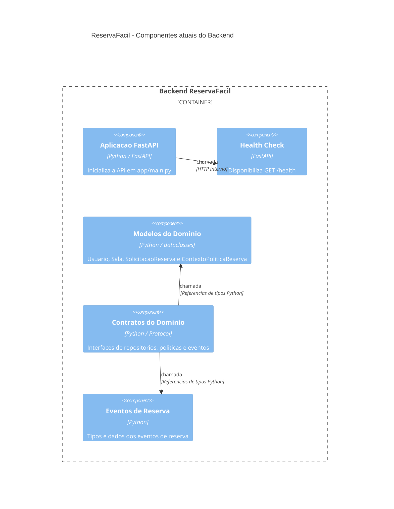

# C4 — Componentes do ReservaFácil

## Estado atual da arquitetura

Este diagrama representa os componentes já criados
na branch `feat/arquitetura-contratos`.

## Componentes previstos

Ainda serao implementados pelos demais integrantes:

- API de cadastros de usuarios e salas.
- Servicos de aplicacao para reservas.
- Repositorios concretos de SQLite.
- Politicas de reserva com Strategy.
- Controle de estados com State.
- Publicador e observadores de eventos.

Esses componentes serao incorporados ao diagrama
conforme seus respectivos Pull Requests forem integrados.

## Evidencias iniciais

- `app/main.py`
- `app/domain/modelos.py`
- `app/domain/contratos.py`
- `app/domain/eventos.py`

Os links permanentes para o codigo serao adicionados
apos a revisao e integracao dos Pull Requests.
